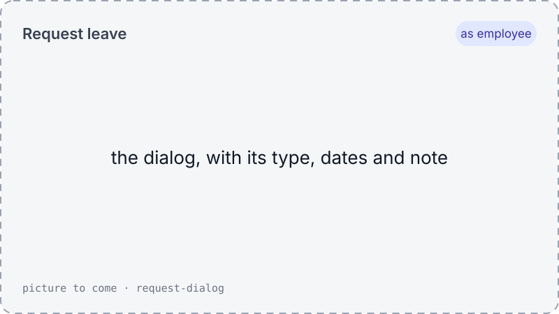
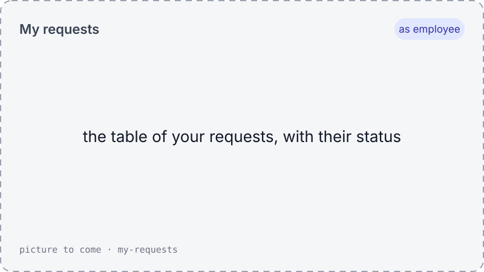
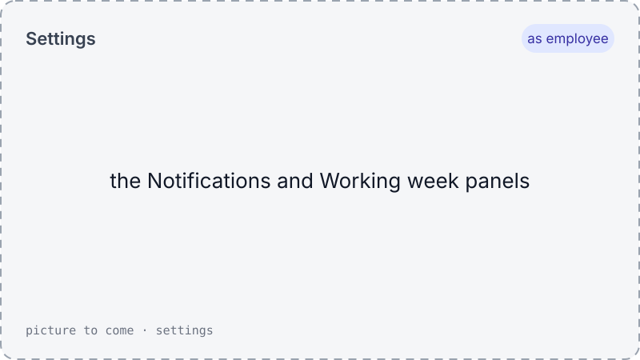

# Leave Planner for employees

Leave Planner is where you ask for time off and see where your requests stand. This guide takes you through checking your balance, asking for leave, following your requests, finding colleagues and changing your settings.

## What you can do

- See how many days of annual leave you have left, and your next time off.
- Ask for annual, sick or unpaid leave.
- Follow your requests as they move from **Pending** to **Approved** or **Declined**.
- Look up colleagues in **People**.
- Choose which emails you get and which days you work in **Settings**.

Deciding on requests is a manager's job, so you don't have a page for it.

## 1. Check your balance and your next time off

Start here when you want to know how much leave you have left.

1. Select **Home** in the **Main** navigation.
2. Read **Your balance**. It shows the days you have left, for example "18 days", with the note "Annual leave left of 25 this year."
3. Read **Next time off**. It shows your next booked dates, the type of leave and its status, for example "16 Mar 2026 – 20 Mar 2026", "Annual leave", **Pending**. When nothing is booked it says "Nothing booked yet."
4. Read **Who's out today** to see which colleagues are away. When nobody is, it says "Everyone is in."

## 2. Ask for time off

Send a request when you want to book leave. Your manager decides on it.

1. Select **Requests** in the **Main** navigation.
2. Select **Request leave**. The **Request leave** dialog opens.

3. In **Type of leave**, choose **Annual leave**, **Sick leave** or **Unpaid leave**.
4. Fill in **First day** and **Last day**.
5. If your manager needs to know anything, add it to **Note for your manager**.
6. Select **Submit request**. The request is sent to your manager.

To close the dialog without sending anything, select **Cancel**.

## 3. Follow your requests

**My requests** lists every request you have made, with its dates, type, number of days, status and note.

1. Select **Requests** in the **Main** navigation.
2. Read the table.

| Status | What it means |
|---|---|
| **Pending** | Your manager hasn't decided yet. |
| **Approved** | Your manager has said yes. |
| **Declined** | Your manager has said no. |

3. To see only some requests, choose **All**, **Pending**, **Approved** or **Declined** in **Show**. The table lists only the requests with that status.

## 4. Find a colleague

**People** shows a card for everyone, with their team and role.

1. Select **People** in the **Main** navigation.
2. Type a name or a team in **Search people**, for example "Design". Only the matching people are shown.
3. Clear the box to see everyone again.

## 5. Change your settings

**Settings** keeps your own choices. Nobody else sees them.

1. Select **Settings** in the **Main** navigation.

2. Under **Notifications**, tick or untick the emails you want:

   | Setting | What it does |
   |---|---|
   | **Email me when a request changes** | Ticked at the start. |
   | **Send me a weekly summary** | Not ticked at the start. |
   | **Sync my leave to my calendar** | Not ticked at the start. |

3. Under **Working week**, tick the days you work. **Mon** to **Fri** are ticked at the start; **Sat** and **Sun** are not.
4. Select **Save settings**.

## If something goes wrong

| What you see | What to do |
|---|---|
| "You have no requests yet." | You haven't asked for leave, or nothing has the status you chose in **Show**. Choose **All** in **Show**, or follow [Ask for time off](#2-ask-for-time-off). |
| "No one matches." in **People** | Check the spelling, or try a shorter search. |
| "You don't have access to this page" | The page is for another role, such as the manager's inbox. Select **Back to Home**. |

Managers decide on requests; see [Leave Planner for managers](manager.md).
