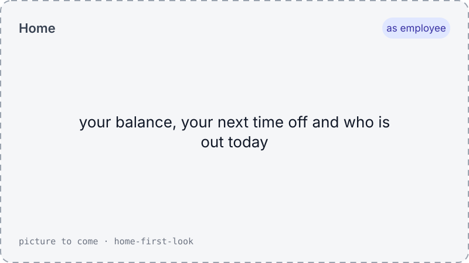

# Getting started with Leave Planner

Leave Planner is where employees ask for time off, and managers decide on it. Everyone can see their own balance and look up colleagues.

## Signing in

Sign in with the account you were given. You land on **Home**. When you have finished, select **Sign out**, at the top of every page.

## Finding your way

The **Main** navigation runs along the top of every page. Your name and role are shown beside it, for example "Rowan Pell · Employee".

| Area | What it is for | Who sees it |
|---|---|---|
| **Home** | Your balance, your next time off and who is out today. | Everyone |
| **Requests** | Your own leave requests, and the button to ask for leave. | Everyone |
| **Inbox** | Requests from your team waiting for a decision. | Managers |
| **People** | A card for each person, with a search. | Everyone |
| **Settings** | Your notifications and working week. | Everyone |

## Your first request

Ask for some time off.

1. Select **Requests** in the **Main** navigation.
2. Select **Request leave**.
3. Choose a **Type of leave**, then fill in **First day** and **Last day**.
4. Add a **Note for your manager** if you want to.
5. Select **Submit request**.

Your request is **Pending** until your manager decides on it.

## Where to go next

- [Leave Planner for employees](employee.md): every task for people who ask for leave.
- [Leave Planner for managers](manager.md): deciding on your team's requests.
