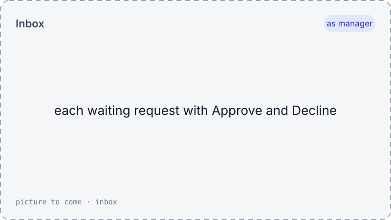

# Leave Planner for managers

As a manager you decide on the leave requests your team sends, and you ask for your own leave like everyone else. This guide takes you through finding the requests waiting for you and answering them.

## What you can do

- See how many requests are waiting for you, and open the **Inbox**.
- **Approve** or **Decline** the requests from your team.
- Everything an employee can do: ask for leave, see your balance, look people up and change your settings. See [Leave Planner for employees](employee.md).

## 1. See what is waiting for you

Start on **Home** to see whether anything needs a decision.

1. Select **Home** in the **Main** navigation.
2. Find **Waiting for you**. It shows how many requests need a decision, for example "2".
3. Select **Open your inbox**, or select **Inbox** in the **Main** navigation.

## 2. Approve or decline a request

The **Inbox** lists the requests from your team waiting for a decision.

1. Select **Inbox** in the **Main** navigation.

2. Read each request: the person's name, the type of leave, the dates and number of days, and their note. For example: Rowan Pell, "Annual leave, 16 Mar 2026 – 20 Mar 2026 (5 days)", "Family visit".
3. Select **Approve** to say yes, or **Decline** to say no.

The person sees your decision in their own list of requests, as **Approved** or **Declined**.

When there is nothing to decide, the **Inbox** says "Nothing waiting for you."

## 3. Ask for your own leave

Your own requests work as they do for employees.

1. Select **Requests** in the **Main** navigation. **My requests** lists your own requests; it says "You have no requests yet." until you make one.
2. Select **Request leave** and fill in the dialog. The steps are in [Ask for time off](employee.md#2-ask-for-time-off).

Your own balance is on **Home**, under **Your balance**.

## If something goes wrong

| What you see | What to do |
|---|---|
| "Nothing waiting for you." in the **Inbox** | You have decided on everything. Check again later. |
| "You have no requests yet." in **My requests** | You haven't asked for leave yourself. |
